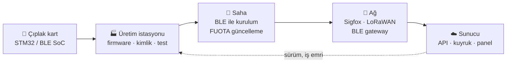

# Semi Avcı

**Yazılım Geliştirici · Gömülü Sistem Entegrasyonu · Üretim ve Saha Yazılımları**

Bir kartın üretim hattında programlanmasından sahadaki telefonla konuşmasına, 
oradan buluttaki panele kadar olan yolun tamamını yazarım.

---

## Uçtan uca: tek kişide bütün zincir

Zincirin her halkasını ayrı ayrı biliyorum; asıl işim halkalar arasındaki kuralı **tek yerde** tutup her uygulamanın aynı kaynaktan beslenmesini sağlamak.

---

## Neler yapabilirim

<table>
<tr>
<td width="50%" valign="top">

### 🔬 Protokolü baytına kadar çözerim
Dokümanı eksik bir cihazla bile konuşurum. Çerçeve, checksum, bayt sırası, komut/onay akışı; **BLE GATT**, **PC/SC APDU**, **Modbus RTU/TCP**, seri port ve ham ikili paketler. Çözdüğüm kuralı testli bir pakete çevirip herkesin kullanacağı tek giriş yaparım.

</td>
<td width="50%" valign="top">

### 🏭 Üretim hattını otomatikleştiririm
Aynı anda birden çok kartı programlayan, firmware ve radyo yığınını yükleyip sürümü doğrulayan, kimliği yazıp sonucu sunucuya bildiren istasyonlar. Hattaki tuhaf vakayı logdan kovalar, kök nedeni bulurum; donanımsız simülatörle tekrar üretirim.

</td>
</tr>
<tr>
<td width="50%" valign="top">

### 📱 Sahada çalışan uygulama yazarım
.NET MAUI ve React Native ile telefondan cihaza doğrudan bağlanan, iş emri ve montaj kaydı işleyen, cihazı kablosuz güncelleyen uygulamalar. Kötü sinyale, uyuyan cihaza, yarıda kalan bağlantıya dayanıklı akışlar.

</td>
<td width="50%" valign="top">

### 🚀 Kendi kendini yöneten sistem kurarım
İmzalı paketle kendini güncelleyen, başarısız olursa önceki sürüme dönen Windows servisleri; tek tıkla kurulum paketleri, sürüm etiketleme ve changelog disiplini. Sahaya çıktıktan sonra elle müdahale istemeyen yazılım.

</td>
</tr>
<tr>
<td width="50%" valign="top">

### 📡 IoT veri hattı kurarım
Sigfox, LoRaWAN ve BLE ağ geçitlerinden gelen paketleri çözen, kalıcı kuyruğa alan ve bağlantı koptuğunda veriyi kaybetmeden teslim eden .NET servisleri; MQTT ve yönetim panelleri.

</td>
<td width="50%" valign="top">

### 💳 Ödeme ve kiosk entegre ederim
WPF/WinForms kiosk akışları, POS terminaliyle mesajlaşma, akıllı kart okuyucular, kart bakiye yükleme ve işlem geçmişi; ödeme senaryolarını donanımsız deneyen test araçları.

</td>
</tr>
</table>

---

## Nasıl çalışırım

| | |
|---|---|
| ✅ **Önce doğruluk, sonra hız** | Birkaç saniyelik kazanç yerine yanlış karta yazılan tek bir kimliği önlemeyi seçerim. |
| 🧪 **Kanıtsız değişiklik yok** | Akışı değiştiren her şey ayarla açılıp kapanır ve gerçek donanımda açık, kapalı ve hatalı durumda denenir. |
| 🧩 **Kural tek yerde yaşar** | Bir protokol kuralı iki uygulamada kopya olarak durmaz; test edilmiş ortak pakete taşınır. |
| 📦 **İş muallakta kalmaz** | Değişiklik commit, test, belge ve gerekiyorsa sürümle biter. |

---

## Kanıt: Orion Üretim Platformu

> Şu an üzerinde çalıştığım, sayaç üretim hattını tek ekrandan yöneten sistem. Yukarıdaki kabiliyetlerin hepsi burada bir arada.

- **5 kanallı paralel ST-LINK** ile STM32WB kartlarına aynı anda firmware, BLE yığını ve FUS yükleme
- Her adımda kart UID'sini yeniden doğrulayan **kimlik ve Sigfox provisioning**
- Sunucudan imzalı paket çekip **kendini güncelleyen istasyon ajanı** ve otomatik geri dönüş
- Masaüstü, web ve mobil uygulamaların paylaştığı **ortak protokol paket ailesi**

---

## Araç kutusu

---

## Açık depolar

| Proje | Açıklama |
|---|---|
| [**hp-victus-cachyos-field-guide**](https://github.com/semiavci11/hp-victus-cachyos-field-guide) | Bir laptop arızasını donanım seviyesine kadar kovaladığım vaka notları: Hall/LID sensörü, flex kablo ve Linux'ta fan kontrolü. Türkçe ve İngilizce. |
| [**Yakıt Hesabı**](https://semiavci11.github.io/yakithesabi-gizlilik/) | React Native ve TypeScript ile yazdığım, verilerini cihazda tutan yakıt ve enerji maliyeti hesaplayıcısı (Android). |

---

Çoğu çalışmam şirket içi depolarda. Donanımla konuşması gereken bir yazılımınız varsa yazın.

